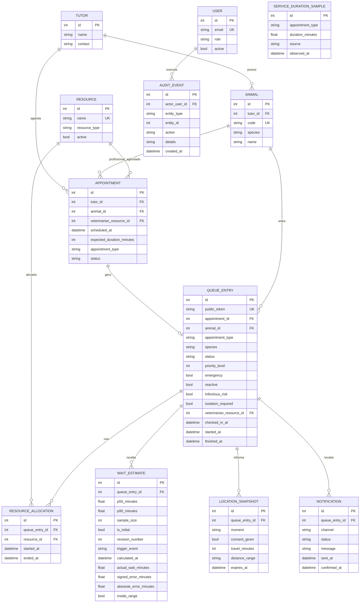

# Modelo de dados — Backend Fila Virtual

## Decisões importantes

1. **Fila não é uma tabela por espécie/motivo.** `QueueEntry` armazena os eixos e a API pode agrupar/filtrar sem perder a disputa por recursos compartilhados.
2. **Emergência não é calculada pelo sistema.** O campo só pode ser alterado por perfil veterinário/admin.
3. **Localização precisa não é persistida.** O backend persiste apenas consentimento, tempo/faixa de deslocamento e expiração.
4. **Previsões são versionadas.** Isso permite comparar previsão inicial, revisões e espera real.
5. **Amostras de campo ficam separadas da fila operacional.** Assim observação direta/retrospectiva pode calibrar a F1 antes de existirem atendimentos reais no sistema.
