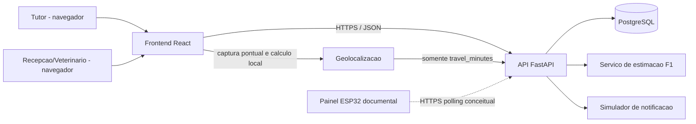

# Arquitetura do sistema

> **Estado em 2026-11-16:** linha de base aprovada pelo GP. Frontend e backend estao integrados na `development`; hospedagem definida no ADR-003; publicacao e teste ponta a ponta externo permanecem em execucao. O hardware integra a entrega somente como prototipo documental.

## Visao geral

## Componentes

| Componente | Responsabilidade | Estado no fechamento |
|---|---|---|
| Frontend React + Vite | Tutor por link publico; recepcao e veterinario autenticados | Integrado ao backend na `development` |
| API FastAPI | Autenticacao, agenda, fila, autoatendimento, F1, F2, F3 e auditoria | Implementada e coberta pela suite backend |
| PostgreSQL/SQLite | PostgreSQL na topologia de producao; SQLite no desenvolvimento e testes | Implementado |
| Alembic | Evolucao controlada do esquema | Implementado |
| Estimacao F1 | Percentis por tipo, revisoes, simulacao da fila e metricas | Implementado; origem `MOCKED` identificada quando habilitada |
| F2 | Consentimento, deslocamento calculado no navegador, fallback e avisos | Implementado com canal `SIMULATOR` e parametros 20/60/10 `MOCKED` |
| F3 | Segregacao, emergencia autorizada, recursos exclusivos e reordenacao | Implementado |
| Hardware | Painel anonimizado com ESP32, display, LED e buzzer | Prototipo documental; construcao fisica fora do escopo |

## Integracao

- API REST sob `/api`, JSON e autenticacao Bearer para rotas internas.
- Recepcao e veterinario usam as telas em `/recepcao`; o tutor acompanha pelo token publico em `/t/{token}`.
- O backend tambem possui registro e autoatendimento autenticado do tutor, embora o frontend atual concentre o cadastro assistido e o acompanhamento pelo link publico.
- A fila pode ser reordenada por veterinario/admin com `PUT /queue/order`; conflitos de versao retornam `409` e exigem recarga.
- A emergencia pode ser declarada ou removida somente por veterinario/admin.
- O frontend calcula uma estimativa de deslocamento no navegador e envia apenas `travel_minutes`.
- O canal `SIMULATOR` nao alega entrega por provedor real.

## Dados e privacidade

- coordenadas nao existem no modelo persistido;
- snapshots de deslocamento expiram conforme configuracao do servidor;
- contato e sintomas nao aparecem no endpoint publico;
- emergencia depende de perfil veterinario/admin;
- amostras `MOCKED` entram na estimativa somente com `ALLOW_MOCKED_ESTIMATES=true` e a resposta informa `data_source=MOCKED`;
- segredos permanecem em variaveis de ambiente.

## Implantacao

Topologia decidida no [ADR-003](../adr/003-hospedagem-vercel.md):

1. frontend estatico na Vercel, com raiz `frontend/`;
2. API FastAPI na Vercel, com raiz `backend/`;
3. PostgreSQL gerenciado pela Neon;
4. migrations executadas contra o banco de producao antes da liberacao da versao;
5. HTTPS obrigatorio e CORS restrito ao dominio publicado;
6. limpeza de snapshots F2 nas operacoes atuais; qualquer cron futuro exige endpoint protegido e nova decisao.

As URLs e o resultado do smoke test somente serao registrados depois da publicacao efetiva. A execucao local documentada permanece como contingencia.

## Referencias tecnicas

- contrato detalhado: `backend/docs/API_CONTRACT.md`;
- modelo ER: `backend/docs/MODELO_DADOS.md`;
- F1: `backend/docs/F1_IMPLEMENTACAO.md`;
- F2: `backend/docs/F2_IMPLEMENTACAO.md`;
- contrato resumido para frontend e QA: `docs/04-arquitetura/contrato-de-interface.md`.
