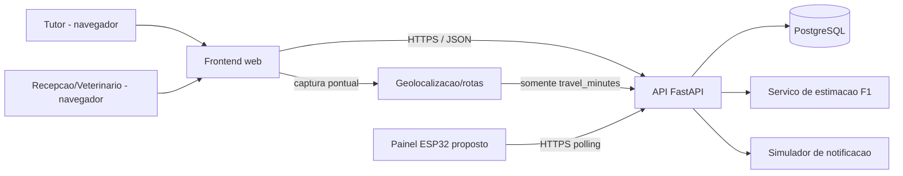

# Arquitetura do sistema

> **Estado em 2026-11-16:** backend integrado; hospedagem decidida no ADR-003 (Vercel + Neon); frontend e publicacao ainda precisam ser validados.

## Visao geral

## Componentes

| Componente | Responsabilidade | Estado |
|---|---|---|
| Frontend web | Interface do tutor, recepcao e veterinario | Pendente de integracao |
| API FastAPI | Autenticacao, agenda, fila, F1, F2, F3 e auditoria | Implementado |
| PostgreSQL/SQLite | Persistencia; SQLite para desenvolvimento | Implementado |
| Alembic | Evolucao do esquema | Implementado |
| Estimacao F1 | Percentis por tipo, simulacao da fila e metricas | Implementado |
| F2 | Consentimento, deslocamento, fallback e avisos | Implementado com simulador |
| Hardware | Painel local de chamada | Proposta documental |

## Integracao

- API REST em `/api`, JSON e autenticacao Bearer para rotas internas.
- Tutor usa token publico aleatorio limitado ao proprio atendimento.
- CORS e configurado por ambiente; `*` nao deve ser usado em producao.
- O frontend calcula/consulta rota e envia somente minutos de deslocamento.
- O canal `SIMULATOR` nao alega entrega por provedor real.

## Dados e privacidade

- coordenadas nao existem no modelo persistido;
- snapshots de deslocamento expiram por configuracao do servidor;
- contato do tutor nao aparece no endpoint publico;
- emergencia depende de perfil veterinario/admin;
- amostras `MOCKED` ficam fora da calibracao oficial F1;
- segredos permanecem em variaveis de ambiente.

## Implantacao

Decidida no [ADR-003](../adr/003-hospedagem-vercel.md):

1. frontend estatico (Vite) na Vercel, projeto com raiz `frontend/`;
2. API FastAPI como funcao Python na Vercel, projeto com raiz `backend/` (sem processo `uvicorn` continuo);
3. PostgreSQL gerenciado na Neon, pela integracao da Vercel;
4. migrations executadas manualmente antes de subir a nova versao;
5. snapshots F2 expirados removidos nas operacoes F2; agendamento por cron diario depende de endpoint ainda nao implementado;
6. HTTPS obrigatorio e CORS restrito ao dominio publicado.

Este documento nao declara URL ou disponibilidade inexistente; as URLs entram no plano de publicacao quando o smoke test passar.

## Referencias tecnicas

- contrato detalhado: `backend/docs/API_CONTRACT.md`;
- modelo ER: `backend/docs/MODELO_DADOS.md`;
- F1: `backend/docs/F1_IMPLEMENTACAO.md`;
- F2: `backend/docs/F2_IMPLEMENTACAO.md`;
- consolidacao de interface: `docs/04-arquitetura/contrato-de-interface.md`.
