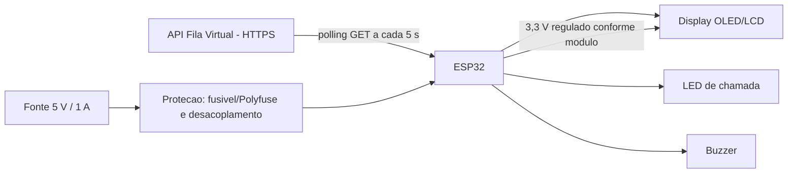

# Esquema de hardware - painel de chamada

> **Status:** proposta documental em 2026-11-15. Prototipo fisico e opcional; inventario/cotacao e modelo exato dos componentes ainda precisam ser anexados.

## Objetivo

Exibir na recepcao uma chamada anonimizada do atendimento e emitir sinal visual/sonoro, sem armazenar dados clinicos no dispositivo.

## Diagrama de blocos

## Componentes propostos

| Componente | Qtd. | Funcao | Criterio de escolha |
|---|---:|---|---|
| ESP32 DevKit | 1 | Wi-Fi, consulta API e controle | Disponivel, baixo custo, HTTPS e ampla documentacao |
| Display OLED I2C ou LCD | 1 | Mostrar codigo e orientacao | Leitura local; modelo depende do inventario |
| LED + resistor | 1 | Sinal visual | Indicacao simples de nova chamada |
| Buzzer ativo 5 V | 1 | Sinal sonoro curto | Nao exige geracao de audio complexa |
| Fonte 5 V / 1 A certificada | 1 | Alimentacao | Margem sobre consumo estimado |
| Polyfuse/fusivel 500-750 mA | 1 | Protecao | Limitar falha na alimentacao |
| Capacitores e cabos | conjunto | Estabilidade e montagem | Conforme datasheets finais |

## Comunicacao

- ESP32 conecta por Wi-Fi da clinica.
- Consulta endpoint dedicado somente leitura por HTTPS.
- Payload minimo proposto: `call_id`, `display_code`, `destination`, `created_at`.
- Nao enviar nome do tutor, animal, contato ou informacao clinica.
- Dispositivo confirma localmente o ultimo `call_id` para evitar repeticao.
- Token do dispositivo deve ser revogavel e ficar fora do codigo-fonte.

O endpoint dedicado ainda nao existe no backend; sua implementacao depende de aprovacao. Sem prototipo, o esquema permanece como entrega documental.

## Alimentacao e consumo estimado

Valores conservadores para dimensionamento inicial; conferir datasheets dos modelos reais.

| Carga | Corrente de pico estimada |
|---|---:|
| ESP32 com Wi-Fi | 240 mA |
| Display | 40 mA |
| Buzzer | 30 mA |
| LED | 20 mA |
| **Subtotal** | **330 mA** |
| Margem de 50% | 165 mA |
| **Corrente minima calculada** | **495 mA** |

Escolha proposta: fonte de **5 V / 1 A**, potencia nominal de **5 W**. A fonte oferece margem para picos, perdas e variacao do display. O regulador da placa alimenta a logica de 3,3 V; perifericos devem respeitar os niveis do modelo escolhido.

## Modos de falha e seguranca

- sem rede: mostrar “Painel offline” e nao repetir chamada antiga;
- API indisponivel: retry com intervalo crescente;
- token invalido: bloquear exibicao e sinalizar manutencao;
- reinicio: recuperar somente chamadas posteriores ao ultimo ID confirmado;
- falha eletrica: protecao de entrada, caixa isolante e cabos sem partes expostas.

## Evidencias ainda necessarias

- inventario do campus ou cotacao com fornecedor, data, preco e prazo;
- datasheets dos componentes exatos;
- validacao do calculo com esses datasheets;
- foto/esquema eletrico se houver prototipo;
- teste de rede, repeticao, queda de energia e dados anonimizados.
