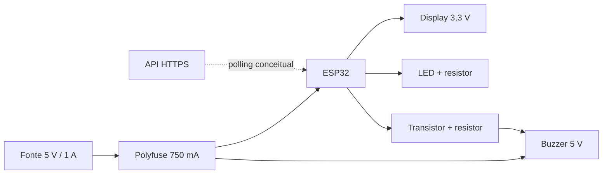

# Esquema de hardware - painel de chamada

> **Status em 2026-11-16:** prototipo documental aprovado pelo GP. Construcao fisica, compra e cotacao estao fora do escopo desta versao.

## Objetivo

Representar um painel que exiba chamada anonimizada e emita sinal visual e sonoro sem armazenar dados clinicos.

## Diagrama

## Componentes

| Componente | Funcao e criterio |
|---|---|
| ESP32 DevKit | Wi-Fi, HTTPS e controle do painel |
| Display OLED I2C 3,3 V | Mostrar codigo e destino sem incompatibilidade logica |
| LED + resistor | Sinal visual com corrente limitada |
| Buzzer ativo 5 V | Sinal sonoro acionado por transistor, nunca direto no GPIO |
| Transistor NPN ou MOSFET + resistor | Isolar o GPIO da corrente do buzzer |
| Diodo de protecao | Usar se o datasheet indicar carga indutiva |
| Fonte 5 V / 1 A | Alimentacao com margem |
| Polyfuse 750 mA | Protecao com folga sobre a corrente calculada |
| Capacitores e cabos | Desacoplamento e conexoes |

## Comunicacao conceitual

- consulta por HTTPS a endpoint dedicado somente leitura;
- payload minimo: `call_id`, `display_code`, `destination`, `created_at`;
- nenhum nome, contato, sintoma ou dado clinico;
- token revogavel fora do codigo-fonte;
- ultimo `call_id` memorizado para evitar repeticao.

O endpoint dedicado nao existe porque o hardware fisico esta fora do escopo. A interface fica documentada para eventual etapa futura autorizada.

## Alimentacao

| Carga | Pico estimado |
|---|---:|
| ESP32 com Wi-Fi | 240 mA |
| Display | 40 mA |
| Buzzer | 30 mA |
| LED | 20 mA |
| **Subtotal** | **330 mA** |
| Margem de 50% | 165 mA |
| **Minimo calculado** | **495 mA** |

A fonte adotada e **5 V / 1 A (5 W)**. O polyfuse de 750 mA evita a falta de folga de uma protecao de 500 mA. Em montagem futura, corrente de manutencao/disparo, cabos e componentes devem ser conferidos nos datasheets.

O buzzer recebe 5 V pela linha protegida e e chaveado pelo transistor. O GPIO fornece somente o sinal de controle em 3,3 V.

## Falhas e limite do entregavel

- sem rede ou API: mostrar painel offline e nao repetir chamada antiga;
- token invalido: bloquear exibicao;
- reinicio: aceitar apenas chamada posterior ao ultimo ID;
- falha eletrica: usar protecao, desacoplamento e caixa isolante.

Este documento conclui o requisito de prototipo de hardware. Nao declara montagem, teste de bancada, foto, cotacao ou funcionamento fisico inexistentes.
