# Manual do usuário

> **Versão:** 2026-11-16, conferida com o frontend da `development` (telas R1–R11 e T1–T6). As capturas foram tiradas em 16/11 com o sistema rodando localmente e a massa de demonstração `MOCKED` (contas `@mock.local` e animais identificados só por código); os números nelas não representam a clínica. Como rodar o sistema: [frontend/README.md](../../frontend/README.md) e [backend/README.md](../../backend/README.md).

## Perfis

- **Recepção:** cadastro, check-in, fila, chamada, avisos com falha e recursos.
- **Veterinário ou admin:** tudo o que a recepção faz e, além disso, declarar emergência.
- **Tutor:** acessa só o próprio atendimento, pelo link que a recepção entrega. Não precisa de login.

## Recepção

### Entrar

1. Abra `/recepcao/login` (localmente, `http://localhost:3000/recepcao/login`).
2. Entre com o e-mail e a senha fornecidos pela equipe.
3. Confira no canto superior o e-mail e o perfil. O botão **Emergência** só aparece para veterinário ou admin.
4. Use **Sair** ao terminar, principalmente em computador compartilhado.

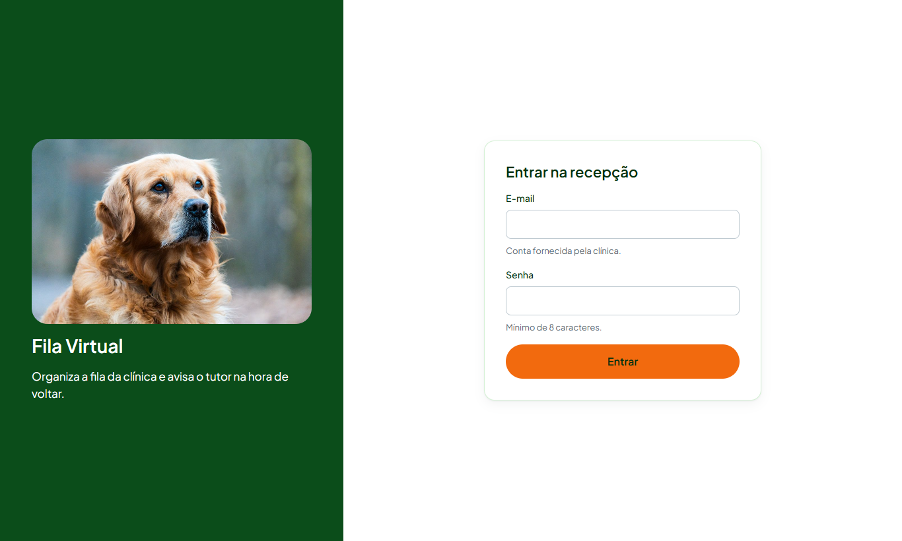

O menu do topo tem cinco telas: **Fila**, **Cadastro**, **Recursos**, **Avisos** e **Indicadores**.

### Colocar um paciente na fila (tela Cadastro)

A tela tem três caminhos, escolhidos pelos botões **Agendamento**, **Encaixe** e **Check-in**:

- **Agendamento:** cadastre o animal com um código (sem nome real do tutor), escolha o tipo de atendimento, o veterinário (opcional), a data e hora e a duração prevista. Clique em **Agendar**. O paciente só entra na fila depois do check-in.
- **Check-in:** escolha um agendamento de hoje e confirme. O paciente entra na fila.
- **Encaixe:** para quem chegou sem horário. Preencha o animal e o tipo; o paciente entra direto na fila.

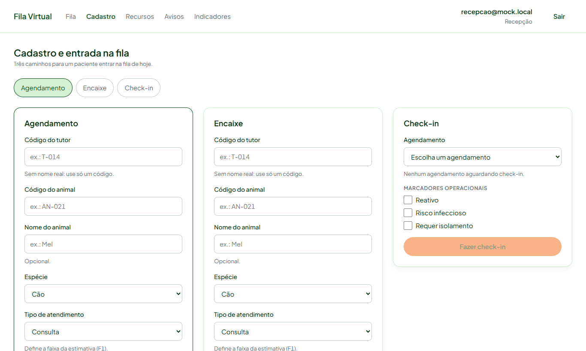

Os botões **Check-in** e **Novo encaixe** no topo da tela Fila levam direto para esses formulários.

Depois do check-in ou do encaixe, a tela mostra o **link do tutor**. Entregue esse link só ao tutor daquele atendimento.

Limitação atual: não existe busca de tutor ou animal. Cada agendamento e encaixe cadastra um tutor e um animal novos.

### Operar a fila (tela Fila)

A fila mostra os pacientes de hoje, com filtros por **espécie**, **tipo de atendimento** e **status**. Cada linha mostra a posição, o estado, a prioridade, a espera estimada (faixa p50–p90) e marcadores como **Reativo**.

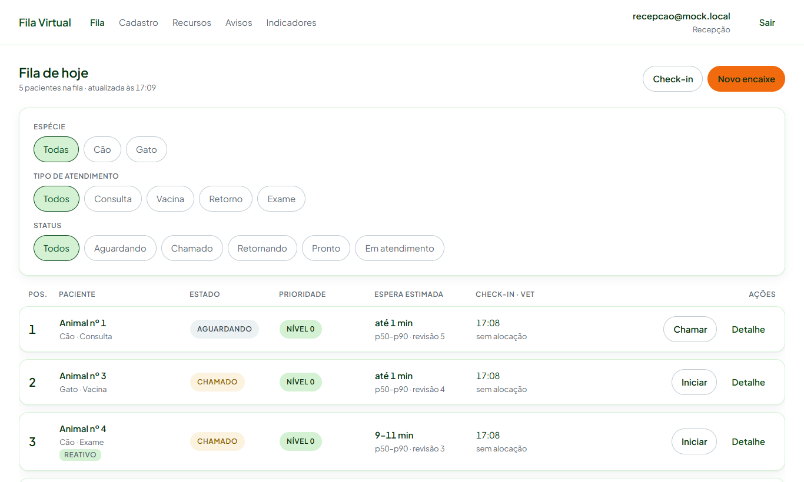

Os botões de cada paciente dependem do estado:

| Estado | Significado | Botões disponíveis |
|---|---|---|
| Aguardando (`WAITING`) | Na fila | **Chamar**, **Emergência** (vet/admin) |
| Chamado (`CALLED`) | Aviso enviado ao tutor | **Iniciar** |
| Retornando (`RETURNING`) | Tutor confirmou que está voltando | **Iniciar** |
| Pronto (`READY`) | Na clínica, pronto para atender | **Iniciar**, **Emergência** (vet/admin) |
| Em atendimento (`IN_SERVICE`) | Atendimento começou | **Finalizar** |
| Concluído (`COMPLETED`) | Atendimento terminou | — |

- **Chamar** envia um aviso **simulado** ao tutor. O sistema não manda WhatsApp nem SMS.
- **Emergência** passa o paciente na frente da fila. Só o veterinário ou o admin decide isso; o sistema nunca classifica gravidade sozinho. Enquanto o atendimento ainda espera, esses perfis também podem usar **Remover emergência**.
- **Detalhe** abre o caso.

Sem filtros ativos, veterinário ou admin também pode reordenar os pacientes pelos controles da fila. O sistema recusa a alteração se outra atualização tiver modificado a fila antes da confirmação; nesse caso, atualize a tela e repita a decisão.

### Detalhe do caso

Mostra o histórico de estimativas, os avisos enviados, a decisão de retorno e os dados do caso. Aqui é possível:

- confirmar um aviso ou marcar que ele falhou;
- avaliar se o tutor consegue voltar a tempo;
- alocar e liberar recursos, como a sala de isolamento, antes de iniciar o atendimento.

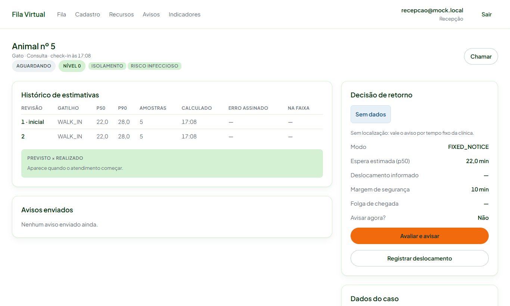

### Recursos

Lista a **sala de isolamento (única)** e os outros recursos, como salas e veterinários. O sistema recusa alocar um recurso exclusivo que já está ocupado. Para usá-lo, libere a alocação anterior no detalhe do caso. Quando um paciente que precisa de isolamento está esperando, a tela avisa.

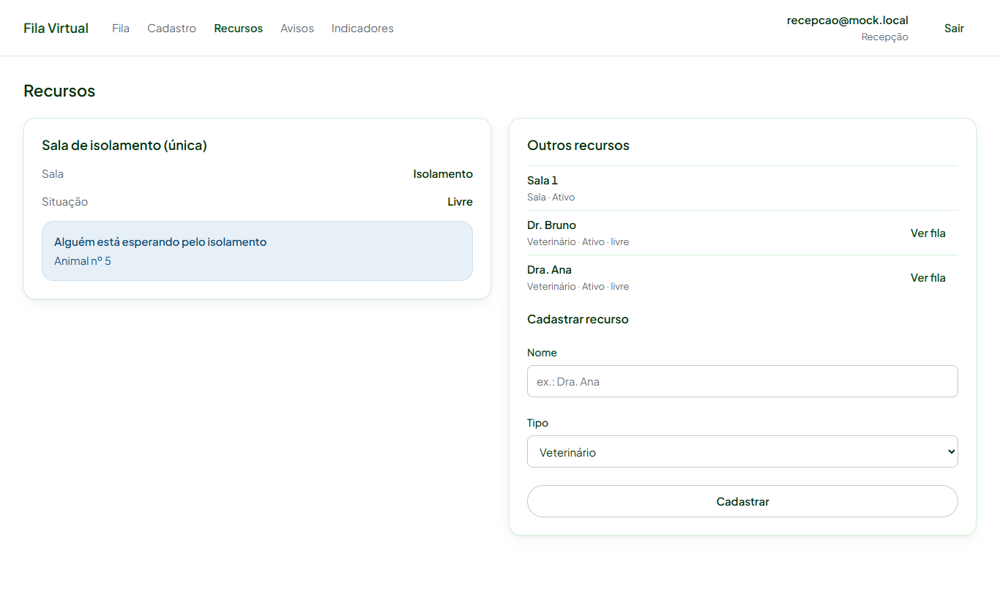

### Avisos com falha

Quando um aviso falha, o caso aparece em **Avisos**. Entre em contato com o tutor pelo meio disponível, descreva o que foi feito e clique em **Registrar providência**. Enquanto a providência não for registrada, o sistema bloqueia uma nova tentativa de aviso para aquele paciente.

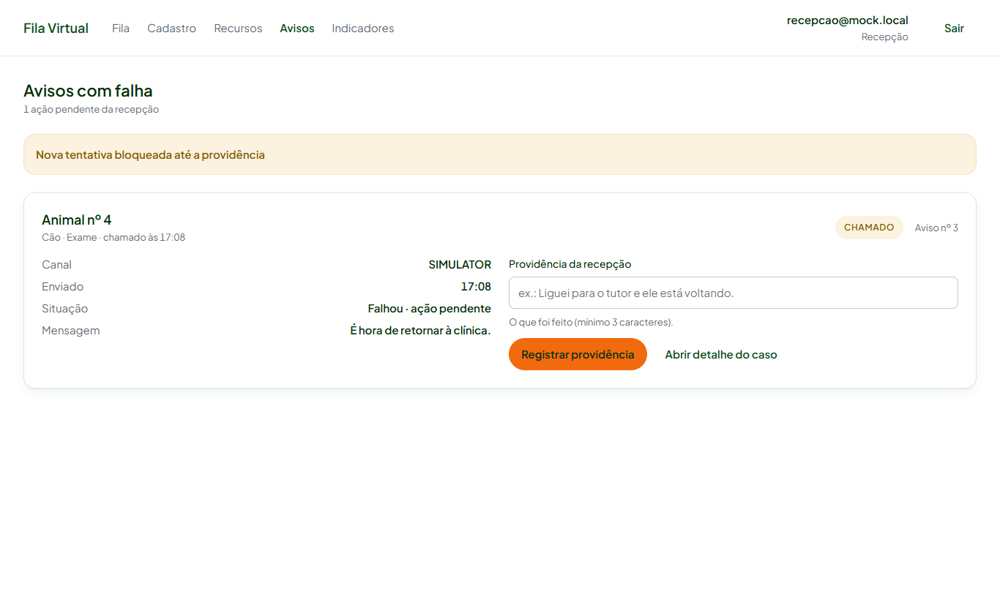

### Indicadores

Mostra a estimativa da F1 por tipo de atendimento, a prontidão da base (se há amostras suficientes) e o histórico do dia, com previsto × realizado e o erro da estimativa.

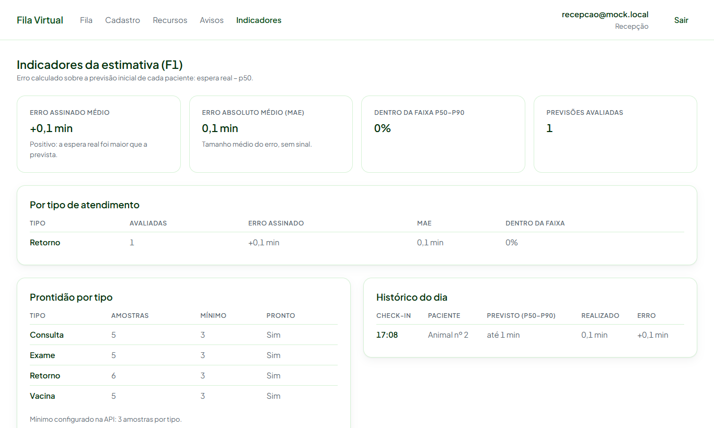

## Tutor (celular)

1. Abra o link recebido na recepção.
2. A tela **Podemos ver onde você está?** explica que a localização é pedida só em três momentos: ao entrar, ao ser chamado e ao voltar.
   - **Permitir:** o navegador calcula os minutos até a clínica e envia só esse número. Coordenadas não saem do celular.
   - **Agora não:** você continua na fila e é avisado com um tempo fixo de antecedência.
3. A tela principal mostra a posição e a espera estimada como faixa (p50–p90). Se não houver amostras suficientes, aparece **Indisponível**, nunca "0 min".
4. Quando for chamado, aparece **É a sua vez!** com a indicação de se dá tempo de voltar. Em **Ver cálculo** estão a espera, o deslocamento, a margem e a folga. Sem localização, aparece "sem localização".

  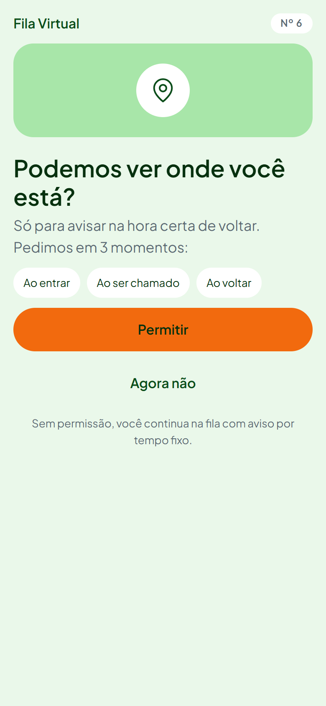
  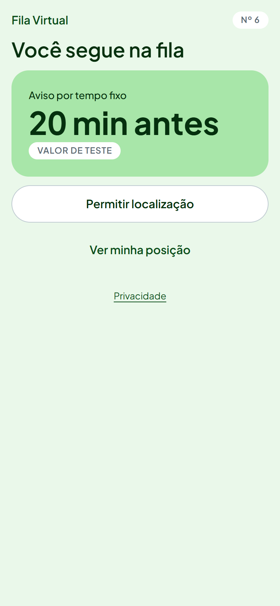
  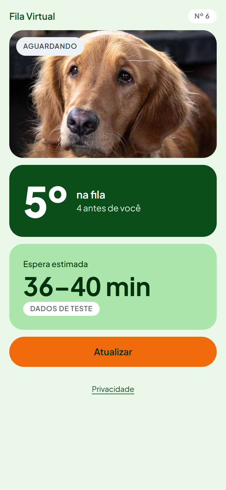
  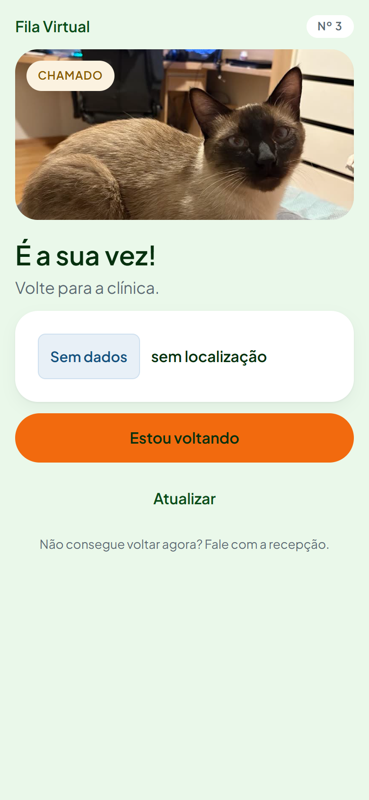

Da esquerda para a direita: pedido de localização, aviso por tempo fixo depois de **Agora não**, posição na fila e chamada.

5. Clique em **Estou voltando**. Se não conseguir voltar, fale com a recepção.
6. Em **Privacidade** está a finalidade do uso da localização.

## Como ler a estimativa (F1)

- **p50:** metade dos atendimentos de referência levou até esse tempo.
- **p90:** limite conservador; 9 em cada 10 levaram até esse tempo. Não é garantia de espera máxima.
- **Indisponível:** faltam amostras do tipo de atendimento. O sistema não inventa um número.
- A estimativa muda quando a fila muda: emergência, início ou fim de atendimento.

Os 40 registros identificados como `MOCKED` compõem o C1-MOCKED aprovado pelo GP para esta entrega. Eles não comprovam coleta em clínica real. Com `ALLOW_MOCKED_ESTIMATES=true`, a F1 pode calcular p50/p90 para a apresentação e informa `data_source=MOCKED`; uma futura coleta real deverá ser registrada e analisada separadamente.

## Solução de problemas

| Problema | O que fazer |
|---|---|
| Login negado | Conferir e-mail, senha e perfil com a equipe |
| Link do tutor inválido ou expirado (tela abaixo) | Conferir se o link é do atendimento certo; gerar novo check-in se preciso |
| Sem estimativa | Ver a prontidão em Indicadores; não informar um valor inventado |
| Localização negada | Nada a fazer: o tutor segue com aviso por tempo fixo |
| Aviso falhou | Resolver em **Avisos** e registrar a providência |
| Recurso ocupado | Liberar a alocação anterior ou escolher outro recurso |
| "Sem conexão" ou erro de rede | Clicar em **Tentar de novo**; se persistir, anotar horário e tela e avisar a equipe |

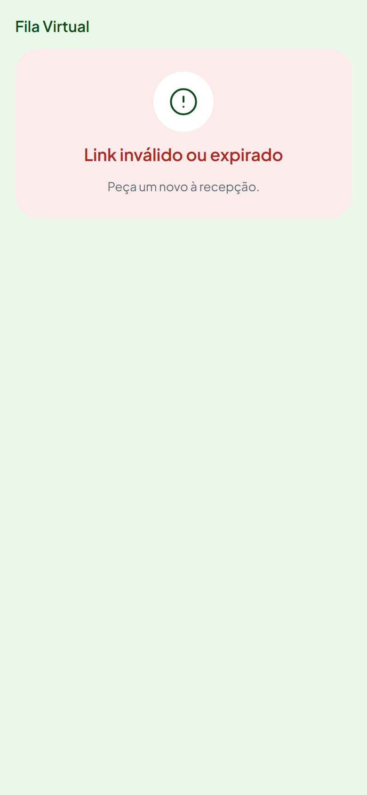

## Privacidade

- Não cadastrar nome real, telefone ou documento na massa de demonstração; use códigos.
- Não compartilhar o link do tutor em grupos.
- Não publicar capturas com senha, token ou link completo.
- Encerrar a sessão em computador compartilhado.
